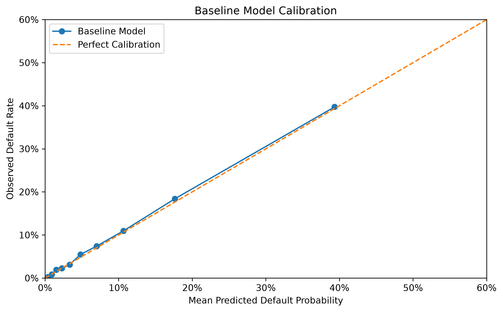
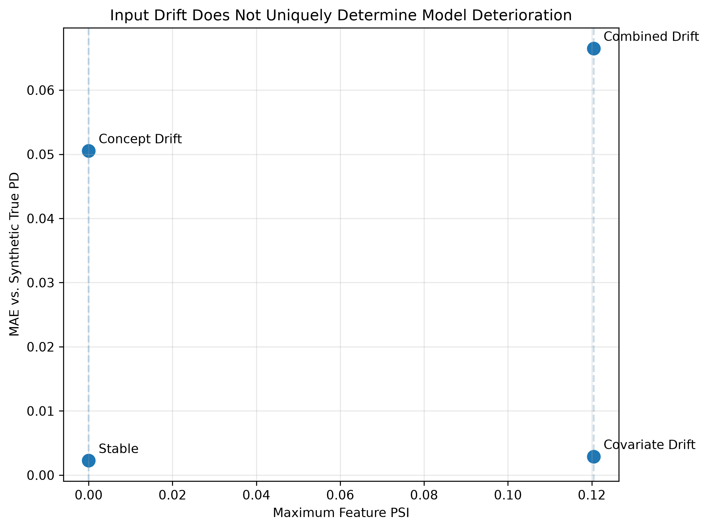
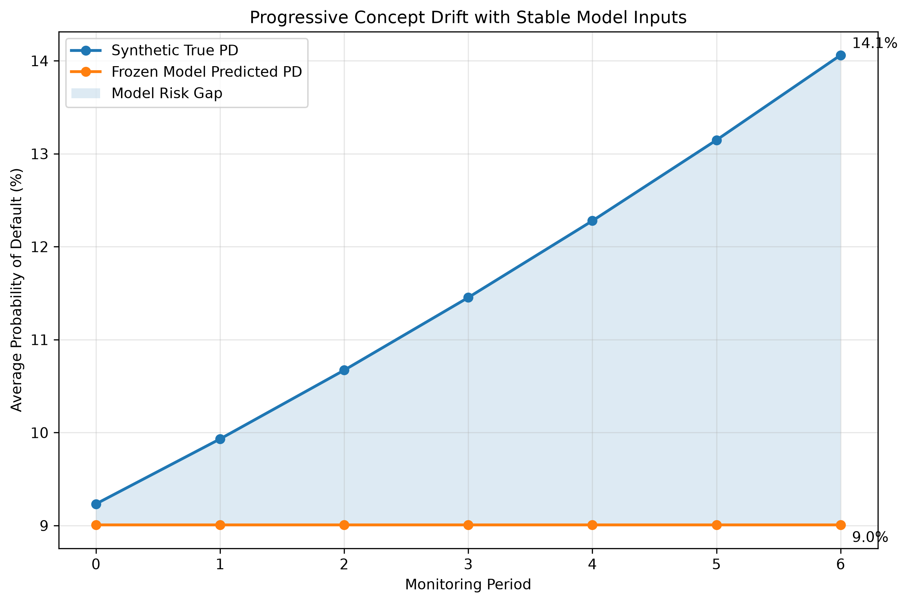

# Adaptive Model Risk

**Adaptive Model Risk** is an open-source research project focused on detecting and diagnosing deterioration in predictive models when the economic environment, population, or underlying relationships in the data change over time.

## Baseline Model Experiment

The first reproducible experiment is now available.

The baseline notebook creates a controlled synthetic credit-risk environment, generates borrower default outcomes from a known probability-of-default process, trains a logistic regression model, and establishes reference performance metrics for later model-deterioration experiments.

**Baseline test performance**

| Metric                    |  Value |
| ------------------------- | -----: |
| ROC AUC                   |  0.839 |
| Brier Score               | 0.0683 |
| Log Loss                  | 0.2368 |
| Calibration Error         | 0.0042 |
| MAE vs. Synthetic True PD | 0.0028 |

These results represent a deliberately healthy baseline model. Subsequent experiments keep the trained model fixed while changing the operating environment to study covariate drift, concept drift, calibration deterioration, and model-performance degradation.

[View the baseline notebook](notebooks/01_baseline_model.ipynb)

### Baseline Calibration

> **Note:** The current experiment uses synthetic data and an intentionally controlled data-generating process. It is designed to study model-risk mechanisms and should not be interpreted as a production credit-risk model or as representative of any financial institution.

## Controlled Model Deterioration Experiments

The second reproducible experiment keeps the trained baseline model fixed and evaluates it under controlled future environments.

The experiments independently manipulate:

$$
P(X)
$$

and:

$$
P(Y \mid X)
$$

to distinguish input-distribution drift from deterioration in the relationship between model inputs and outcomes.

Four controlled environments form a $2 \times 2$ experimental design:

| Scenario        | $P(X)$ | $P(Y \mid X)$ |
| --------------- | -------- | --------------- |
| Stable          | Baseline | Baseline        |
| Covariate Drift | Changed  | Baseline        |
| Concept Drift   | Baseline | Changed         |
| Combined Drift  | Changed  | Changed         |

A separate economic-shock experiment also changes both the unemployment distribution and the true sensitivity of default risk to unemployment.

### Key Experimental Results

| Scenario        | Max PSI | ROC AUC | Calibration Error | MAE vs. Synthetic True PD |
| --------------- | ------: | ------: | ----------------: | ------------------------: |
| Stable          |  0.0000 |  0.8383 |            0.0019 |                    0.0023 |
| Covariate Drift |  0.1204 |  0.8300 |            0.0043 |                    0.0029 |
| Concept Drift   |  0.0000 |  0.8316 |            0.0511 |                    0.0505 |
| Combined Drift  |  0.1204 |  0.8237 |            0.0673 |                    0.0665 |
| Economic Shock  | 10.0183 |  0.8241 |            0.0793 |                    0.0792 |

The controlled results illustrate two central findings:

* detectable input drift does not necessarily imply substantial model deterioration;
* substantial model deterioration can occur even when monitored input distributions remain unchanged.

In particular, the Concept Drift experiment uses exactly the same model-input observations as the Stable environment. Input-drift statistics are therefore zero, while calibration error and error relative to the known synthetic true probability increase materially.

The progressive-deterioration experiment further shows that probability accuracy can worsen gradually while input drift remains zero and ROC AUC remains relatively stable.

[View the model deterioration notebook](notebooks/02_model_deterioration.ipynb)

### Input Drift vs. Model Deterioration

### Progressive Concept Drift

> **Note:** These experiments use synthetic controlled environments designed to isolate model-risk mechanisms. Scenario magnitudes, including the severe economic-shock PSI, are experimental stress settings and should not be interpreted as universal production monitoring thresholds.

## Adaptive Monitoring and Early-Warning Experiment

The third reproducible experiment extends the controlled deterioration framework into a sequential monitoring system designed to identify abnormal changes over time.

The experiment simulates 36 monthly monitoring periods with:

* recurring calendar seasonality;
* gradual population shift;
* gradual deterioration in the relationship between predictors and outcomes;
* combined population and relationship changes;
* an abrupt economic regime shock;
* delayed outcome labels.

The frozen baseline model is not retrained during the experiment. Instead, monitoring evidence accumulates as new monthly cohorts arrive.

### Two Monitoring Channels

The framework separates evidence into two complementary channels.

**Input monitoring** evaluates changes in the model-input distribution using:

* Population Stability Index (PSI);
* Kolmogorov-Smirnov statistic;
* Wasserstein distance.

**Outcome monitoring** evaluates whether predicted probabilities remain reliable after outcomes become available using:

* prediction-versus-observed default-rate gaps;
* calibration error.

ROC AUC and Brier score are retained as diagnostic measures but are not used directly as primary alert components.

This separation is important because a changing population does not necessarily imply that the model relationship has deteriorated, while deterioration in the relationship between inputs and outcomes can occur even when the input distribution remains stable.

### Seasonality-Aware Monitoring

Raw drift measures can change substantially because of normal seasonal patterns.

To avoid treating expected calendar variation as abnormal deterioration, the experiment estimates healthy reference distributions separately by calendar month. Monitoring statistics are converted into empirical percentiles relative to the expected healthy distribution for the corresponding month.

The experiment therefore evaluates whether a monitoring signal is unusual **relative to what is normally expected at that point in the seasonal cycle**, rather than relying on one fixed drift threshold throughout the year.

### Sequential Alert System

Monitoring signals are combined using exponentially weighted moving averages (EWMA) so that recent evidence receives greater weight while isolated monthly fluctuations have limited influence.

The experiment uses:

* EWMA smoothing parameter: 0.30;
* 2,000 healthy-null simulated trajectories;
* 1,500 trajectories for component normalization;
* 500 held-out trajectories for system-level calibration;
* a 99th-percentile raw system threshold;
* a persistence rule requiring at least 2 raw alerts within 3 eligible monitoring periods.

The resulting calibrated system-score threshold is approximately:
0.962926

### Detection Results

| Scenario                      | First Confirmed Alert | Detection Delay | Change Progress at Detection | Confirmed Evidence |
| ----------------------------- | --------------------: | --------------: | ---------------------------: | ------------------ |
| Seasonal Stable               |                  None |               — |                            — | None               |
| Gradual Covariate Shift       |             Period 18 |       5 periods |                          50% | Input              |
| Gradual Concept Deterioration |             Period 22 |       9 periods |                          83% | Outcome            |
| Gradual Combined Shift        |             Period 18 |       5 periods |                          50% | Input + Outcome    |
| Abrupt Regime Shock           |             Period 18 |       5 periods |                         100% | Input + Outcome    |

The stable evaluation path produces no confirmed alert.

The Gradual Covariate Shift scenario is detected through the input channel without a confirmed outcome alert. In contrast, pure Concept Deterioration produces no confirmed input alert and is detected only after outcome evidence becomes available.

This illustrates a central result of the project:

> **Input distribution shift and deterioration in model validity are related but distinct monitoring problems.**

### Label Delay and Detection Latency

Outcome-based monitoring cannot react immediately when outcomes are observed with delay.

In the experiment, labels become available three months after each cohort is generated. For Concept Deterioration, the first affected cohort begins at Period 13, but its outcome evidence first becomes available at Period 16. A confirmed outcome alert occurs at Period 22.

The observed detection delay therefore reflects both:

1. **information delay** — waiting for affected outcomes to become observable; and
2. **statistical latency** — accumulating enough persistent evidence to distinguish deterioration from normal variation.

### Stable Ranking Does Not Guarantee Reliable Probabilities

The concept-deterioration experiment also demonstrates that ROC AUC can remain comparatively stable while calibration deteriorates.

The model may continue to rank higher-risk observations above lower-risk observations even as its predicted probabilities become systematically unreliable.

For this reason, discrimination metrics alone are insufficient for monitoring models whose probability estimates are used for risk-sensitive decisions.

[View the adaptive monitoring notebook](notebooks/03_adaptive_monitoring.ipynb)

### Adaptive Monitoring Figures

The experiment produces reproducible figures illustrating:

* joint system scores across deterioration scenarios;
* input-versus-outcome monitoring evidence;
* confirmed detection delays;
* healthy-null threshold calibration;
* calendar-aware seasonality effects on PSI;
* stable discrimination alongside deteriorating calibration.

> Note: The monitoring thresholds and scenario magnitudes in this experiment are derived from a controlled synthetic environment. They are intended to demonstrate monitoring methodology and should not be interpreted as universal thresholds for production model-risk management.

## Motivation

Financial institutions increasingly rely on statistical and machine-learning models for credit risk, forecasting, fraud detection, customer analytics, and other decision-making processes.

These models are generally developed using historical relationships between predictors and outcomes. However, economic conditions, customer populations, market behavior, and relationships among variables can change.

As a result, a model that performed well when it was developed may remain operational while becoming progressively less reliable.

This project investigates methods for identifying these changes, measuring their effect on predictive models, diagnosing the causes of deterioration, and evaluating possible responses.

## Research Focus

The project will investigate several related forms of model instability, including:

- data distribution shift;
- prediction drift;
- model performance degradation;
- calibration deterioration;
- changes in relationships between predictors and outcomes;
- model sensitivity to changing economic regimes.

A central objective is to distinguish between **changes in data that are statistically observable** and **changes that materially affect model reliability**.

## Initial Research Questions

The project currently focuses on questions including:

1. How early can changes in data distributions indicate deterioration in financial predictive models?
2. Which types of distribution shift are most strongly associated with deterioration in predictive performance or calibration?
3. Can model-aware drift measures distinguish consequential model changes from benign population changes?
4. Can controlled stress scenarios identify conditions under which a previously validated model becomes unreliable?
5. How can multiple monitoring signals inform decisions to continue monitoring, investigate, recalibrate, retrain, or redevelop a model?

## Planned Project Components

The project is expected to include:

- public financial datasets;
- baseline predictive models;
- temporal model validation;
- drift-detection methods;
- model-performance monitoring;
- calibration monitoring;
- economic-regime comparisons;
- controlled stress experiments;
- diagnostic methods;
- reproducible Python implementations and notebooks.

## Current Status

The project has progressed through three reproducible stages: baseline model development, controlled model-deterioration experiments, and sequential adaptive monitoring.

Completed work currently includes:

* a reproducible synthetic credit-risk data-generating process;
* a frozen baseline logistic regression pipeline;
* held-out discrimination and calibration evaluation;
* comparison of model-predicted risk with known synthetic true risk;
* controlled Stable, Covariate Drift, Concept Drift, Combined Drift, and economic regime-shock environments;
* experimental separation of changes in $P(X)$ from changes in $P(Y \mid X)$;
* PSI, KS, and Wasserstein input-drift monitoring;
* progressive deterioration experiments across multiple monitoring periods;
* deterministic calendar seasonality in monitored inputs;
* calendar-aware healthy-null normalization of monitoring statistics;
* delayed outcome availability;
* separate input and outcome monitoring channels;
* EWMA-based sequential evidence accumulation;
* empirically calibrated system-level alert thresholds;
* persistence-based confirmed-alert rules;
* detection-delay and false-alert measurement;
* reusable drift and monitoring utilities;
* reproducible monitoring figures and result summaries.

The experiments demonstrate that observable input drift and deterioration in model validity are related but distinct phenomena. Population changes can trigger input-drift evidence without indicating that the predictive relationship has failed, while material deterioration in probability reliability can occur without abnormal changes in monitored inputs.

The adaptive monitoring experiment further demonstrates that the timing and source of monitoring evidence depend on the type of change. Population shift can be identified through contemporaneous input evidence, while deterioration in the relationship between inputs and outcomes may only become detectable after outcome labels arrive and sufficient statistical evidence accumulates.

The current project therefore provides a controlled experimental foundation for studying not only whether a model has changed, but **what type of change has occurred, how early it can be detected, and which monitoring evidence supports that conclusion**.

Future development will extend this framework toward additional model classes, monitoring settings, datasets, and response strategies such as investigation, recalibration, retraining, or redevelopment.

## Documentation

Project documentation will be maintained in the [`docs`](docs/) directory.

## Data

Only public, appropriately licensed, or independently generated data will be used.

See [`data/README.md`](data/README.md) for data-management principles.

## Disclaimer

This is an independent research project and does not represent the views or practices of any current or former employer or other organization.

See [`DISCLAIMER.md`](DISCLAIMER.md) for the full disclaimer.

## License

This project is licensed under the Apache License 2.0.
